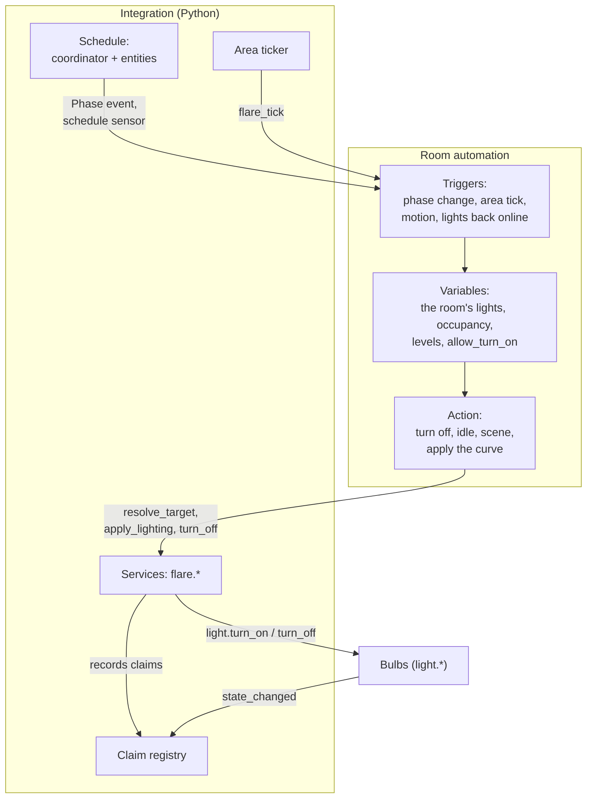
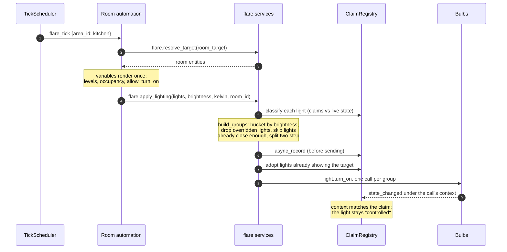

# FLARE internals

How FLARE works inside: what runs where, how it hooks into Home
Assistant, and how the pieces talk to each other. It's for someone about
to change the code. Users want `docs/`. For the reasons behind a
decision, see `CLAUDE.md`; these pages describe the system as it is and
link there when the why matters.

## Reading order

| Page | What it covers |
|---|---|
| [The big picture](#the-big-picture) (below) | The two halves, and what happens when a room updates |
| [Code layout](layout.md) | Packages, the dependency rule, config entries, devices and entities |
| [The event loop](event-loop.md) | Every place FLARE hooks into Home Assistant: setup order, listeners, timers, storage, contexts |
| [Schedules and the curve](schedules.md) | How a schedule becomes a phase, a brightness and a colour |
| [The room automation](room-automation.md) | The blueprint: triggers, the variables chain, the one gate that switches lights on |
| [Services and grouping](services.md) | `flare.apply_lighting` from call to bulb, and the other eleven services |
| [Claims and override protection](claims.md) | How FLARE tells its own writes from anyone else's |
| [Flares](flares.md) | The light that fronts a room automation |
| [Setup and upgrades](setup.md) | Config flows, area setup, the blueprint repairs, migrations |
| [The dashboard](frontend.md) | How the JavaScript gets into the page, the strategies and the cards |

## The big picture

FLARE is two pieces, and the dependency runs one way.

- **The integration** (`custom_components/flare/`) is Python running
  inside Home Assistant. It works out what lights should look like (the
  *schedule* and its *curve*), sends that to bulbs efficiently, and
  remembers which writes were its own (*claims*) so it can leave a light
  alone once someone else changes it. Everything it does is an entity or a
  service.
- **The blueprint** (`custom_components/flare/blueprints/flare.yaml`)
  is the room automation built on those services. It decides *when* a room
  updates and *whether* a light may come on. Each room is one automation
  made from it.

### One room update, end to end

The commonest path: an area's tick fires, and the room drifts with the
curve.

Every other path is a variation on this one. Motion uses a shorter
transition and may switch lights on. A room emptying calls
`flare.turn_off`. A phase change also moves scenes on. Someone changing a
light by hand shows up at step 10 as a context and values that match no
claim, and from then on step 5 leaves that light out.

## Words used here

These pages use the code's own terms. User-facing pages don't; the
lexicon in `DOCUMENTATION.md` lists the ones to keep out of `docs/`.

| Term | Meaning |
|---|---|
| schedule | One "sensor" subentry of the Schedules entry: five boundary times and sixteen curve values, each its own entity. |
| phase | Morning, Day, Evening or Night. |
| curve | Brightness and Kelvin over the day, easing between phases. |
| room | Who's writing, for override protection: a `room_id` (the automation) and its lights. |
| claim | A record of FLARE's write to one light: the context it used and what it asked for. |
| tick | `flare_tick`, a plain bus event fired for each area once per interval. |
| flare | A `light` entity fronting a room automation, for voice assistants and HomeKit. |
| context | Home Assistant's `Context`: every state change carries the id of whatever caused it. |
| group | One `build_groups` output: lights sharing a brightness, split by how they're sent. |
