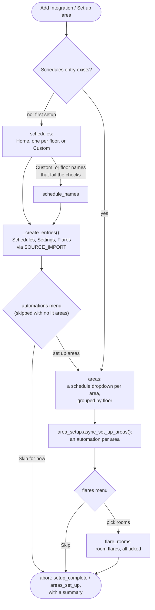
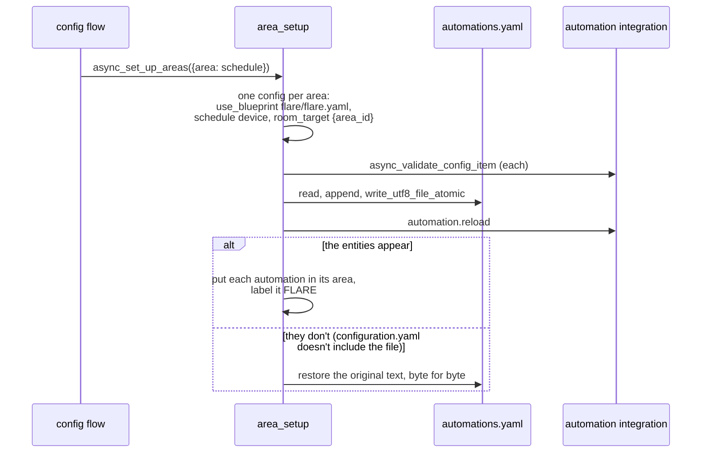
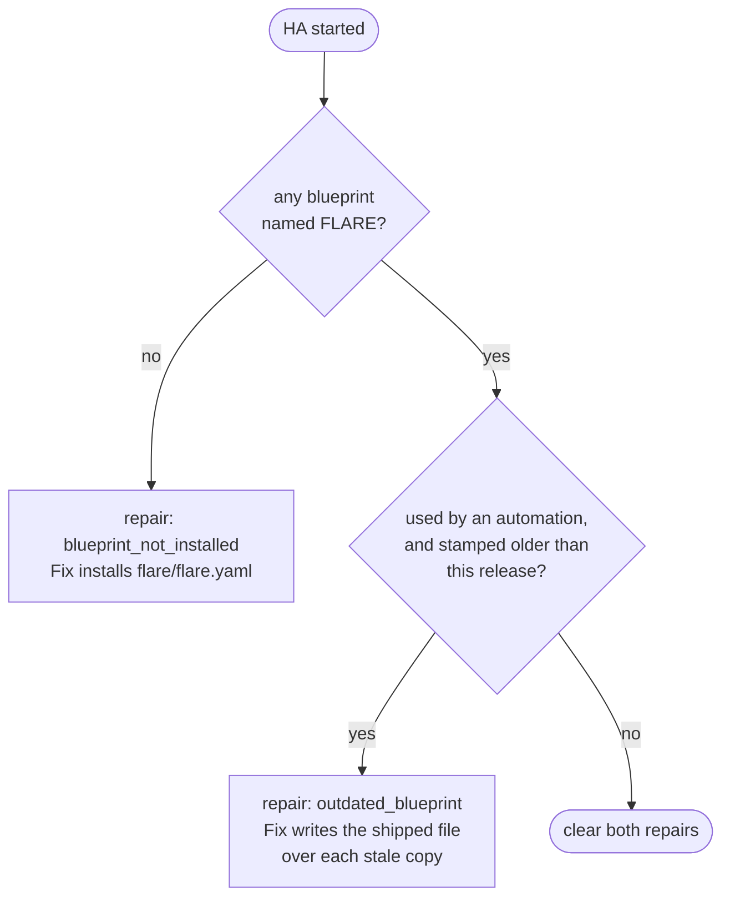

# Setup and upgrades

How FLARE gets from "Add Integration" to rooms that light themselves, and
how it keeps an installed blueprint current.

## The main flow

`FlareConfigFlow` (`config_flow.py`) is the integration page's main
button. The first time it sets everything up. After that, it's
**Set up area**.

- **The entries are created through `SOURCE_IMPORT`**: the flow starts a
  hidden import flow for each missing one. Each entry type has a fixed
  unique id (`flare_schedules`, `flare_tracking`, `flare_flares`), so
  there's only ever one of each, and deleting one and adding it back works.
- **The flow ends on an abort carrying a summary, never on an entry.** HA's
  "integration added" dialog would put every device of the entry the flow
  completes on through a rename-and-place form, with no way to suppress it.
- **First setup raises a repair** linking to a page reload, since a page
  open during setup never loads the dashboard's JavaScript (see
  [frontend.md](frontend.md#getting-into-the-page)).

## Subentry and options flows

| Flow | Where | Does |
|---|---|---|
| `SensorSubentryFlow` | Schedules entry, **Add schedule** | a new schedule; Reconfigure shows it as YAML to copy out or replace, and applying sets the entities, leaving the subentry untouched |
| `FlareSubentryFlow` | Flares entry, **Add flare** | a flare over a FLARE-blueprint automation, or a custom one by input |
| `FlareOptionsFlow` | Settings entry, **Configure** | tick interval and gap, minimum change, two-step models |

Reconfiguring a subentry ends with `async_update_and_abort`. Subentry
changes don't reload an entry by themselves, so each entry has an update
listener (`_async_reload_entry`) that does. It yields once
(`asyncio.sleep(0)`), so several subentries added in one go, as area setup
does, reload the entry once.

## Area setup (`area_setup.py`)

It writes `automations.yaml` the way HA's own automation editor does
(`components/config/automation.py`), because there's no public API for
it. A lock in `hass.data` keeps two setups from interleaving.

- **Which areas are offered**: every area holding a light by HA's own rule
  (`target_entities({"area_id": ...})`), so an area with only hidden or
  categorised lights isn't offered.
- **"Already set up"** means an automation labelled FLARE sits in the
  area. That only unticks the area: running Set up area again adds another
  automation.
- **Not handled yet**: a failure part-way leaves what was already created.

## Keeping the blueprint current

HA never installs a custom integration's blueprints, so FLARE checks for
its own once HA has started (`async_at_started`), from the Settings entry.

- Ours is recognised **by name**, "FLARE". Only copies an automation uses
  count as outdated: HA never removes an unused copy, and a repair about
  one nobody reads couldn't be silenced.
- The version stamp is in the blueprint's `description`, since the
  `blueprint:` block is a closed schema and the description survives every
  import route. It's `0.0.0-dev` in source. `scripts/release.py` writes
  the real version into each release's zip, along with the manifest and
  `BLUEPRINT_VERSION`.
- A blueprint that fails to load comes back from `async_get_blueprints()`
  as the exception itself, hence `isinstance` rather than a `None` check.

## Migrations

`async_migrate_entry` handles version 3. Minor version 1 to 2 is FLARE
2.0: it removes the old zone subentries (taking their devices, entities and
claims with them) and retitles a "Zones" entry "Settings". Dropping the
claims fails open, since FLARE takes every room back on its next update.

## Getting a build onto a real house

HACS installs only released zips, so a development build is written over
an installed release file by file. The steps are in `CLAUDE.md`
("Getting a build onto the live instance"). Try it in the sandbox first.
