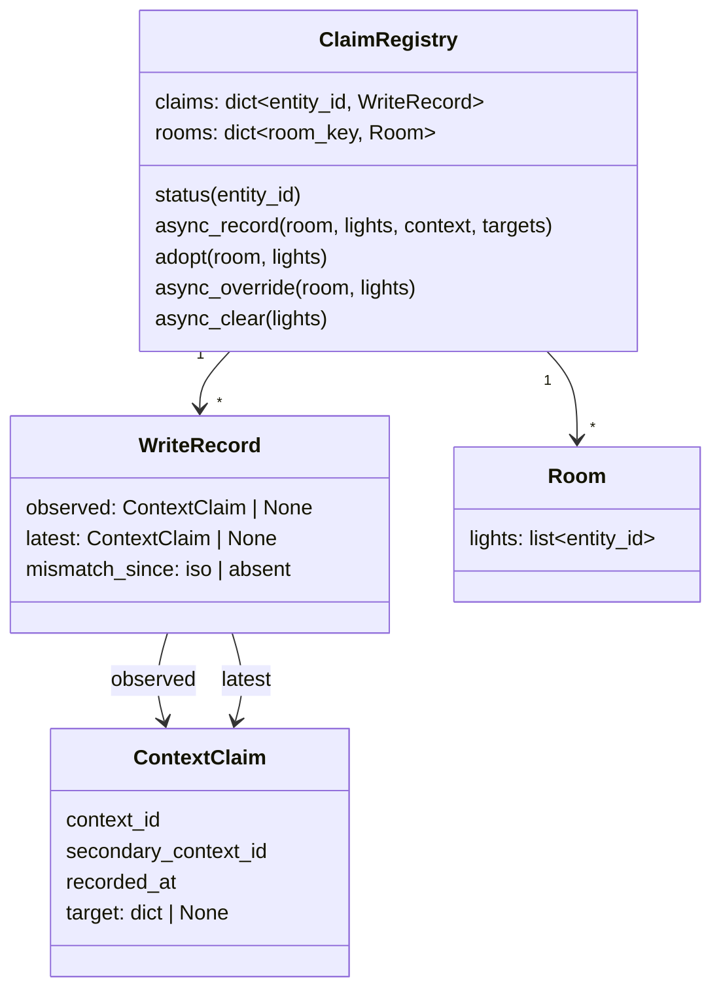
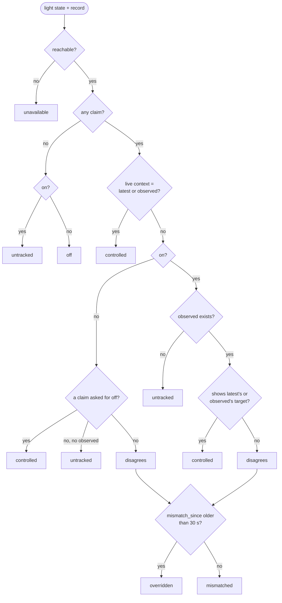
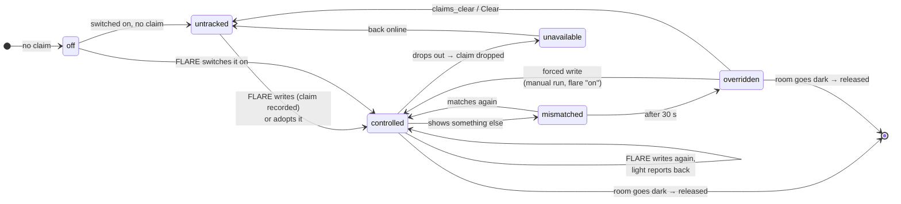
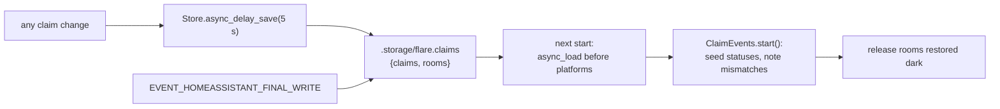

# Claims and override protection
{: .no_toc }

{: .internals }
> Part of [Architecture]({{ site.baseurl }}/architecture/), for contributors and the curious.
> Nothing here is needed to use FLARE.

Override protection is FLARE leaving a light alone once someone else has
changed it. It hangs on one question, asked fresh on every write: **is
this light still showing what FLARE last did to it?** The answer comes
from comparing the light's live state with a record of FLARE's own writes,
its *claims*.

There's no "overridden" flag set once by a trigger. A trigger firing once
blocks only the run it fires in (lesson 2 in [CLAUDE.md](https://github.com/danrspencer/flare/blob/main/CLAUDE.md)). Re-asking
against live state every time is what makes everything else fall out:
room-empty, light-off and reconnect releases all just happen.

## The pieces

| Module | Holds | Pure? |
|---|---|---|
| `tracking/override_protection.py` | `classify()`, the decision table, and `classify_state()`, its adapter for a live HA state | yes |
| `tracking/matching.py` | `shows()`: does a light's report match a target? | yes |
| `tracking/claims.py` | `ClaimRegistry`: claims, rooms, the Store, the state listener | no |
| `sensor.py` | `ClaimEvents` (statuses, events), the counts, each light's status sensor | no |

## The data

**One claim per light**, whichever caller wrote it, so two automations
driving the same light never mistake each other's writes for overrides.

**Two claims in each record**:

- `latest` is FLARE's most recent write, not yet seen landing.
- `observed` is a state FLARE can safely write over: a write it has seen
  land, or for a light's first-ever write, the context it had just before.

On each new write, if the light's live context matches `latest`, that
write landed and is promoted to `observed`. If it still matches
`observed`, the write never landed and `observed` stays as it was. Either
way the light is still FLARE's, so a dropped write can't lock FLARE out.

**A target** is what a write asked for: `{brightness, color_temp_kelvin}`,
`{brightness, rgb_color}`, or `{state: off}` for a turn-off. A light
reported under a stranger's context is still FLARE's if it shows the
target. That covers a bulb reporting after HA has forgotten the write's
context, which happens 5 seconds after the call.

**A room** is the caller naming itself: `room_id`, which for the blueprint
is the automation, keyed by its entity-registry id so a rename keeps it.
Its lights are the latest `room_entities` it named, plus whatever it wrote,
plus any light it still holds a claim on, so every claim it made can be
released with it. A call with no `room_id` writes but records nothing, and
doesn't read claims either. That's the blueprint's **Override Protection**
switch.

## Deciding: `classify()`

`overridden` and `mismatched` both **block**: grouping leaves the light
out unless the call has `force`. The difference is only in what's
reported. A light becomes `overridden` once its mismatch has lasted 30
seconds (`MISMATCH_GRACE`). Until then it's `mismatched`: blocked, so a
real change is never written over, but not counted or announced. Most
short mismatches are FLARE's own write still landing, or a bulb reporting
a stale value as it reconnects.

**Being switched off is an override.** `classify()` doesn't short-circuit
on off. FLARE's own turn-offs record `{state: off}` as their target, which
is how a room switched off at bedtime can come on again but a lamp
switched off by hand stays off.

Everything that judges a light goes through `classify_state()`. Grouping
calls it through `EntityLookup.externally_set()`, and the sensors and
`claims_check` through `ClaimRegistry.status()`. They drifted apart twice
when each did its own, and `test_one_classifier_adapter.py` fails if
anything else calls `classify()`.

### What a light "shows" (`matching.py`)

| Reading | Rule |
|---|---|
| brightness | `brightness`, within the Settings entry's tolerance (5% by default), never less than 2 |
| Kelvin | `color_temp_kelvin`; else a white's `xy_color` read as Kelvin if it's within 0.02 Duv of the Planckian locus; never RGB |
| same mired | two Kelvins that floor to the same mired are the same to a Zigbee bulb |
| near mired | within the Settings entry's tolerance (5 mireds by default), about the smallest change anyone notices |
| out-of-range target | match the target as asked, or clamped to the bulb's advertised range |
| RGB | `rgb_color`, only against an RGB target, within 10 per channel |

Never Kelvin by way of RGB: HA's Kelvin→RGB and xy→RGB conversions differ
by about 13 in red at 6500K, so a bulb showing exactly what was asked would
read as something else.

## A light's life

## The listener

`ClaimRegistry.async_start_listening` follows exactly the claimed lights,
through `async_track_state_change_event`, and re-subscribes whenever the
set of claimed lights changes. It follows their registry entries too, with
`async_track_entity_registry_updated_event`. For each change to one:

| Change | Effect |
|---|---|
| any change | `note_mismatch`: set `mismatch_since` when it first disagrees, clear it when it matches again |
| on/off → unavailable/unknown (*dropped*) | its claim is deleted, so its reconnect isn't read as an override; its rooms are checked for release |
| on/off → off (*went off*) | each room containing it is released if none of its claimed lights is on |
| none/unavailable/unknown → on/off (*arrived*) | each room is released if every claimed light has now reported and none is on |
| renamed in the registry | its claim and its place in its rooms move to the new entity ID |
| deleted from the registry | its claim and its place in its rooms go |

The rules the listener keeps:

- **Nothing reported while HA is stopping counts.** MQTT marks lights
  unavailable as it disconnects, which would drop every claim just before
  the Store's final save.
- **`went_off` needs a real starting state.** Lights reconnect one at a
  time after a restart, and the first back being `off` while its siblings
  are still `unknown` mustn't release the room.
- **Unavailable counts as dark for release**, so one dead bulb can't hold
  a room open forever. Only claimed lights count, so a TV backlight the
  room doesn't drive can't either.

## Releasing a room

Once **none of a room's claimed lights is on**, the room lets go of all of
them (`_release_if_dark`). That's deliberate: a light then switched on by
hand, or back from unavailable, has no claim, reads `untracked`, and FLARE
takes it to the curve. Keeping your own setting in a dark room is what a
flare is for. A light in two rooms is released when either goes dark.

Lights that went off while HA wasn't watching never send an on → off, so
claims restored from storage get a settled check
(`release_settled_dark_rooms`): once every claimed light in the room has
reported on or off, and none is on.

## Persistence

- A restart gives every light a fresh context, so a restored claim can
  only match by value. A light still showing FLARE's target stays
  `controlled`; one changed before the restart keeps its stored
  `mismatch_since`, so it's `overridden` at once.
- A light deleted while HA was down never sends a registry event. Its
  restored claim counts as dark, and goes when its room next does.
- A crash loses the last 5 seconds of claims and fails open: an unclaimed
  light is free to drive.

## Showing it

Where the claims are kept (the registry and its Store) is separate from
how they're shown, and nothing that shows them holds state of its own.

- **Each room light has a status sensor**, `sensor.<light>_flare_status`,
  on the light's own device: what `classify_state` says, with `claimed`,
  `asked` (FLARE's last target, unrecorded) and `rooms`. It updates on its
  light's state changes and on `SIGNAL_CLAIMS_UPDATED`.
- **The counts**, `sensor.flare_controlled_lights` and
  `sensor.flare_overridden_lights`, on FLARE's own device. `untracked`
  counts as controlled, since either way the light isn't excluded.
- **The claim events**, fired by `ClaimEvents`:

| Event | When | Filed under |
|---|---|---|
| `flare_lights_controlled` | a room takes lights it wasn't driving, gathered for 3 s, lit lights only | the Controlled count |
| `flare_light_overridden` | a light becomes `overridden`, with both claims and its live values | the Overridden count |
| `flare_lights_released` | a room goes dark, or Clear | `button.flare_clear` |

Each event carries one of FLARE's entities as `entity_id` and FLARE's
`device_id`. That's how they reach FLARE's Activity, and how the dashboard
tells the three kinds apart. A light going back to controlled after an
override is churn, not news, and is silent. The first refresh after start
seeds the statuses without firing, so a restart doesn't announce anything.
