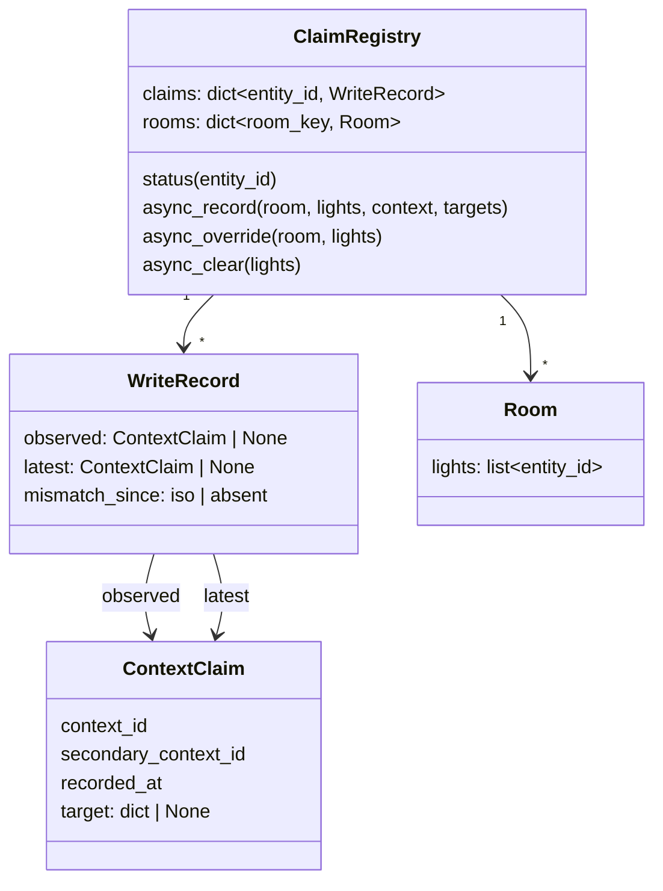
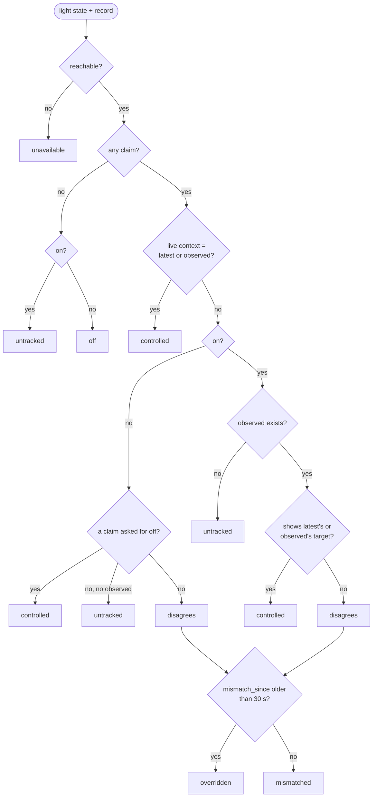
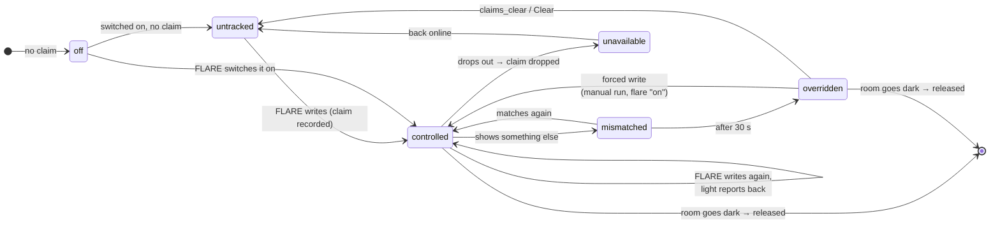
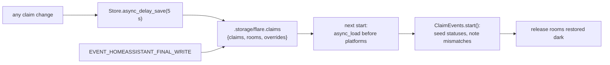

# Claims and override protection
{: .no_toc }

{: .internals }
> Part of [Architecture]({{ site.baseurl }}/architecture/), for contributors and the curious.
> Nothing here is needed to use FLARE.

Override protection is FLARE leaving a light alone once someone else has
changed it. It hangs on one question, asked fresh on every write: **is
this light still showing what FLARE last did to it?** The answer comes
from comparing the light's live state with a record of FLARE's own writes,
its *claims*.

There's no "overridden" flag set once by a trigger. A trigger firing once
blocks only the run it fires in (lesson 2 in [CLAUDE.md](https://github.com/danrspencer/flare/blob/main/CLAUDE.md)). Re-asking
against live state every time is what makes everything else fall out:
room-empty, light-off and reconnect releases all just happen.

## The pieces

| Module | Holds | Pure? |
|---|---|---|
| `tracking/override_protection.py` | `classify()`, the decision table, and `classify_state()`, its adapter for a live HA state | yes |
| `tracking/matching.py` | `shows()`: does a light's report match a target? | yes |
| `tracking/claims.py` | `ClaimRegistry`: claims, rooms, the Store, the state listener | no |
| `sensor.py` | `ClaimEvents` (statuses, events), the counts, each light's status sensor | no |

## The data

**One claim per light**, whichever caller wrote it, so two automations
driving the same light never mistake each other's writes for overrides.

**Two claims in each record**:

- `latest` is FLARE's most recent write, not yet seen landing.
- `observed` is a state FLARE can safely write over: a write it has seen
  land, or for a light's first-ever write, the context it had just before
  and what it was showing then.

On each new write, if the light's live context matches `latest`, that
write landed and is promoted to `observed`. If it still matches
`observed`, the write never landed and `observed` stays as it was. Either
way the light is still FLARE's, so a dropped write can't lock FLARE out,
even if the light reports the same state again under a new context.

**A target** is what a write asked for — `{brightness, color_temp_kelvin}`,
`{brightness, rgb_color}`, or `{"state": "off"}` for a turn-off — stored in the exact form Home
Assistant sends to the light (`matching.sent()`). For example, if a light can't take Kelvin
directly, a Kelvin target is stored as the RGB values Home Assistant converts and sends instead.
If a light reports back under an unrelated context (for instance, after Home Assistant drops
the call's context 5 seconds later), it still counts as FLARE's as long as its state matches the
target.

**A room** identifies the caller (`room_id`, which for the blueprint is the automation entity),
keyed by its entity registry ID so renaming the automation preserves its room. A room's light
list includes its latest `room_entities`, every light it has written to, and any light it still
holds a claim on, so all of those claims can be released together when the room goes dark. A
call with no `room_id` writes to the lights without reading or recording claims — that is what
the blueprint's **Override Protection** toggle controls.

## Deciding: `classify()`

`overridden` and `mismatched` both **block**: grouping leaves the light
out unless the call has `force`. The difference is only in what's
reported. A light becomes `overridden` once its mismatch has lasted 30
seconds (`MISMATCH_GRACE`). Until then it's `mismatched`: blocked, so a
real change is never written over, but not counted or announced. Most
short mismatches are FLARE's own write still landing, or a bulb reporting
a stale value as it reconnects.

**Being switched off is an override.** `classify()` doesn't short-circuit
on off. FLARE's own turn-offs record `{state: off}` as their target, which
is how a room switched off at bedtime can come on again but a lamp
switched off by hand stays off.

Everything that judges a light goes through `classify_state()`. Grouping
calls it through `EntityLookup.externally_set()`, and the sensors and
`claims_check` through `ClaimRegistry.status()`. They drifted apart twice
when each did its own, and `test_one_classifier_adapter.py` fails if
anything else calls `classify()`.

### What a light "shows" (`matching.py`)

| Check | Rule |
|---|---|
| Brightness | `brightness` within the Settings tolerance (5% by default), with a minimum floor of 2 points for dim targets. |
| Kelvin | `color_temp_kelvin`; if reported in `xy_color`, converted to Kelvin as long as it lies within 0.02 Duv of the Planckian locus. Never read via `rgb_color`. |
| Same mired | Two Kelvin values that floor to the same mired are treated as equal, because Zigbee bulbs operate in mireds. |
| Near mired | Within the Settings tolerance (5 mireds by default, roughly one just-noticeable difference). |
| Out-of-range target | Matches either the target as asked or the target clamped to the bulb's advertised min/max range. |
| RGB | `rgb_color` compared only against an RGB target, by summing channel differences up to twice the colour tolerance (10 by default, minimum floor 4). |
| Kelvin on an RGB-only light | For a light that supports colour but neither `color_temp` nor `rgbww` (such as an RGB strip), a Kelvin target is converted via `color_temperature_to_hs` and compared against `rgb_color` using the RGB rule. |
| Capability filtering | Brightness isn't compared on on/off lights, and colour isn't compared on dimmers, because `light.turn_on` drops unsupported attributes. A light with unknown `supported_color_modes` is compared on all attributes. |

`matching.py` never derives Kelvin from `rgb_color`: Home Assistant's Kelvin-to-RGB and
xy-to-RGB conversions differ by around 13 in red at 6500 K, so a bulb showing exactly what was
asked would fail the check. The only exception is a light that cannot accept Kelvin natively,
where Home Assistant itself performs the conversion (`color_temperature_to_hs`) and the light's
xy report reads 2700 K back as ~1870 K — for those lights, the claim stores and compares the
converted RGB target that Home Assistant sends.

## A light's life

## The listener

`ClaimRegistry.async_start_listening` follows exactly the claimed lights,
through `async_track_state_change_event`, and re-subscribes whenever the
set of claimed lights changes. It follows their registry entries too, with
`async_track_entity_registry_updated_event`. For each change to one:

| Change | Effect |
|---|---|
| any change | `note_mismatch`: set `mismatch_since` when it first disagrees, clear it when it matches again |
| on/off → unavailable/unknown (*dropped*) | its claim is deleted, so its reconnect isn't read as an override; its rooms are checked for release |
| on/off → off (*went off*) | each room containing it is released if none of its claimed lights is on |
| none/unavailable/unknown → on/off (*arrived*) | each room is released if every claimed light has now reported and none is on |
| renamed in the registry | its claim and its place in its rooms move to the new entity ID |
| deleted from the registry | its claim and its place in its rooms are removed |

`ClaimRegistry.async_start_listening` also follows the registry entry of each entity a room is
keyed by. When that automation or entity is deleted, its room is removed along with any claims
on lights that no other room tracks (`_forget_deleted_rooms`, which also runs when claims load at
startup).

The rules the listener keeps:

- **Any state reported while HA is stopping is ignored.** MQTT marks lights
  unavailable as it disconnects, which would drop every claim just before
  the Store's final save.
- **`went_off` needs a real starting state.** Lights reconnect one at a
  time after a restart, and the first back being `off` while its siblings
  are still `unknown` mustn't release the room.
- **Unavailable counts as dark for release**, so one dead bulb can't hold
  a room open forever. Only claimed lights count, so a TV backlight the
  room doesn't drive cannot hold it open either.

## Releasing a room

Once **none of a room's claimed lights is on**, the room releases all of its claims
(`_release_if_dark`). Deleting them is deliberate: if a light is later switched on by hand or
comes back online from unavailable, it has no claim (`untracked`), so FLARE takes control of it
and sets it to the curve. (Keeping your own brightness or colour from a dark room is what a
flare is for.) If a light belongs to two rooms, its claim is released as soon as either room goes
dark.

Lights that went off while Home Assistant was shut down never fire an `on` → `off` state
transition on startup, so claims restored from storage run a settled check
(`release_settled_dark_rooms`): a restored room is released once every claimed light in it has
reported `on` or `off` and none of them is `on`.

## Persistence

- A restart gives every light a fresh context, so a restored claim can
  only match by value. A light still showing FLARE's target stays
  `controlled`; one changed before the restart keeps its stored
  `mismatch_since`, so it's `overridden` at once.
- A light deleted while HA was down never sends a registry event. Its
  restored claim counts as dark, and goes when its room next does.
- A crash loses the last 5 seconds of claims and fails open: an unclaimed
  light is free to drive.
- `overrides` is the override log (`log_override`), holding the last 50 overrides. Each entry
  records both claims, the live values, the light's raw colour attributes (`matching.reported()`),
  its device manufacturer and model, the integration providing it, and the active tolerances.
  Entries are logged when `ClaimEvents` fires `flare_light_overridden` (which carries a subset of
  the same fields) and are surfaced only in the Settings entry's diagnostics download.

## Showing it

Where claims are stored (the registry and its `Store`) is separate from how they are presented,
and none of the entities hold state of their own:

- **Status sensors** (`sensor.<light>_flare_status`) sit on each light's own device and report
  what `classify_state` returns, along with `claimed`, `asked` (FLARE's last target, unrecorded),
  and `rooms`. Each sensor updates on its light's state changes and on `SIGNAL_CLAIMS_UPDATED`.
- **Count sensors** (`sensor.flare_controlled_lights` and `sensor.flare_overridden_lights`) sit
  on FLARE's own service device. `untracked` lights are counted as controlled, since either way
  they aren't excluded from updates.
- **Claim events**, fired by `ClaimEvents`:

| Event | When | Filed under |
|---|---|---|
| `flare_lights_controlled` | a room takes lights it wasn't driving, gathered for 3 s, lit lights only | the Controlled count |
| `flare_light_overridden` | a light becomes `overridden`, with both claims and its live values | the Overridden count |
| `flare_lights_released` | a room goes dark, or Clear | `button.flare_clear` |

Each event carries one of FLARE's entities as `entity_id` and FLARE's `device_id`, which routes
it into FLARE's Activity and lets the dashboard distinguish the three event kinds. A light
returning from `overridden` to `controlled` is routine state churn rather than news, so no event
is fired. The initial refresh after startup seeds statuses silently so restarts don't flood the
logbook.
