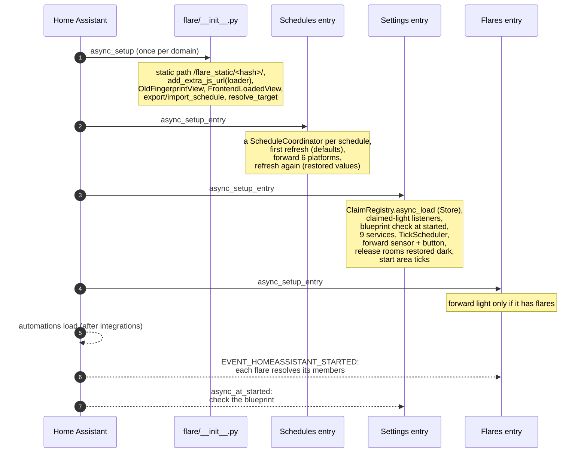
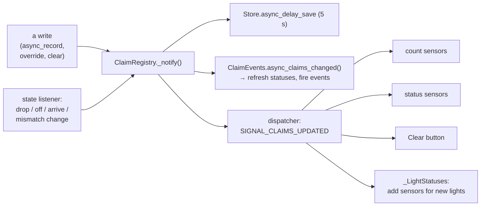
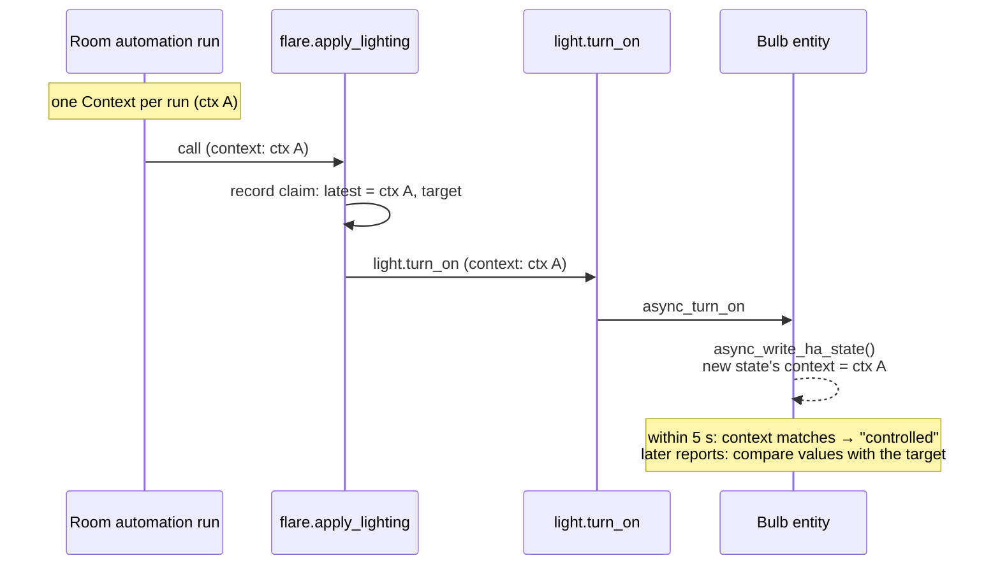

# The event loop
{: .no_toc }

{: .internals }
> Part of [Architecture]({{ site.baseurl }}/architecture/), for contributors and the curious.
> Nothing here is needed to use FLARE.

Home Assistant runs one asyncio event loop, and nearly everything FLARE
does happens on it, as a reaction to something: a state change, a timer,
a service call, a registry update. This page lists every hook and explains
the rules they follow.

## Callbacks and coroutines

Home Assistant code comes in three shapes, and getting the shape wrong
fails silently until a real event loop runs it.

| Shape | Marked | Runs | FLARE uses it for |
|---|---|---|---|
| callback | `@callback def` | on the loop, to completion, no awaiting | listeners, timers, the claim registry's writers |
| coroutine | `async def` | on the loop, yielding at each `await` | service handlers, setup, anything that calls a service |
| plain function | neither | **in the executor** (a worker thread) | only file and hashing work, through `async_add_executor_job` |

A listener or timer handed a plain function that touches `hass` runs it
in a worker thread, where `hass.async_create_task` raises. That's lesson 7
in [CLAUDE.md](https://github.com/danrspencer/flare/blob/main/CLAUDE.md), and it's why every listener here carries `@callback`.
Check `core.py`'s `get_hassjob_callable_job_type` before trusting a fix
in this area: unit tests don't catch it.

**Atomic by construction.** A callback can't be interrupted, so anything
done inside one is one step as far as the rest of HA is concerned. The
claim registry's writers (`async_record`, `async_override`,
`async_clear`) are callbacks for this reason. In
`apply_lighting` there's no `await` between planning the writes and
recording their claims, so no state change can land in between and be
misjudged. (The `async_` prefix is HA's convention for "must run on the
loop", not "is a coroutine".)

## Startup

The order inside the Settings entry matters.

1. **Claims load before the platforms**, so the sensors start with them.
2. **The services are registered before any platform**, so nothing can
   call one that isn't there yet.
3. **The claim events start inside the sensor platform** (`ClaimEvents.start()`).
   They seed every light's status on the spot, which also notes the
   mismatch of a claim restored from before a restart.
4. **Only after that** are rooms restored dark released, so the release is
   announced in Activity.
5. **The blueprint check waits for `async_at_started`**: during setup no
   automation has loaded, so every blueprint looks unused.

Flares wait for `EVENT_HOMEASSISTANT_STARTED` for the same reason:
automations load after integrations, so a flare can't read its
automation's inputs until then.

## Every hook

### Bus listeners

| Listener | Where | Reacts by |
|---|---|---|
| each claimed light's state | `ClaimRegistry.async_start_listening`, re-subscribed as the claimed set changes | dropping a claim when its light goes unavailable, releasing a room gone dark, noting mismatches |
| a light's own state | each `_LightStatusSensor` | rewriting its status |
| a flare's member lights | `FlareLight`, via `async_track_target_selector_state_change_event` | recomputing the group's state |
| `area_registry_updated` | `_tick_areas` | handing the ticker the new set of areas |
| each claimed light's registry entry | `ClaimRegistry.async_start_listening`, alongside its state listener | moving a claim with a rename; dropping it with a deletion |
| a light's registry entry | each `_LightStatusSensor` | following a rename; going with its light when it's removed |
| an automation's registry entry | each `FlareLight`, for its own automation | retracking when it's renamed or removed |
| `automation_reloaded` | `FlareLight` | re-reading the automation's lights |
| `homeassistant_started` | `FlareLight` | first membership, once automations exist |
| `homeassistant_stop` | Settings entry, `ClaimEvents` | stopping the ticker and timers |

### Timers

| Timer | Interval | Where |
|---|---|---|
| Area tick | each area once per `tick_interval` minutes (default 1), `tick_gap` seconds apart (default 1) | `TickScheduler`, chaining `async_track_point_in_utc_time` |
| Schedule refresh | 60 s, plus on demand (debounced, at most 10 s) | `ScheduleCoordinator` (`DataUpdateCoordinator`) |
| Claims save | 5 s after a change, and at shutdown | `Store.async_delay_save` |
| Mismatch recheck | once, 31 s after a light first mismatches | `ClaimEvents._recheck_after_grace` |
| Controlled announcement | 3 s after a room's first light is taken | `ClaimEvents._controlled_soon` |

There's no polling of claim statuses. Everything that can move a count
reaches the state listener: a drop, a light going off, one arriving, a
mismatch starting or ending. The 30-second grace is the only change that
time makes by itself, and it gets its own recheck.

### Signals

`SIGNAL_CLAIMS_UPDATED` (dispatcher) is how the registry tells everything
showing claims to redraw: the count sensors, the status sensors, the Clear
button's `tracked` count, and `_LightStatuses`, which adds a status sensor
the first time a room names a light.

`ClaimEvents` is reached directly, through the `ClaimListener` protocol,
rather than by signal, because it must refresh before the sensors redraw.
`_notify()` calls it first. It's a protocol so `tracking/` needn't import
`sensor.py`.

## Contexts: telling FLARE's writes apart

Every state change in HA carries a `Context`. A service call made with a
context passes it to the entity, and the entity's next state write carries
it. Override protection is built on that.

Four facts shape everything built on contexts:

- **One context per automation run.** Every call in a run shares it, so
  `context.user_id` can't tell FLARE's write from another automation's,
  but `context.id` can.
- **An entity forgets the context 5 seconds after the call.** A slow bulb
  that reports later does so under a fresh context, with the values that
  were asked for. That's why every claim also records its `target`, and a
  light matching the target by value counts as FLARE's.
- **Two-step writes make child contexts.** Brightness and colour go out
  as separate calls, each with its own `Context(parent_id=...)`, created
  before the claims are recorded so both ids are in the claim.
- **A restart gives every light a new context.** Restored claims can only
  ever match by value.

## Ordering subtleties

- **The Phase event fires after the sensor updates.** One coordinator
  refresh updates the schedule sensor and the Phase `event` entity. The
  event entity defers its fire with `loop.call_soon`, so an automation
  woken by it reads the sensor's new phase, not the old one. That's
  needed: HA starts the automation's run inside the event entity's own
  state write, so its `variables:` render before anything after it.
- **`variables:` render once, at trigger time.** Nothing in the
  blueprint's `action:` may delay, or later steps would act on a stale
  snapshot (see [The room automation]({{ site.baseurl }}/architecture/room-automation/)).
- **Claims are recorded before the write.** A run cancelled part-way
  (`mode: restart`, a two-step bulb mid-sleep) still leaves the claim. A
  claim for a write that never lands does no harm: the light still matches
  its previous claim.

## Shutdown

- **Nothing a light reports while HA is stopping counts**
  (`hass.is_stopping`). MQTT marks its lights unavailable as its
  connection closes, which would otherwise drop every claim just before
  the Store's final write.
- The Store writes once more at `EVENT_HOMEASSISTANT_FINAL_WRITE`, so a
  clean restart loses nothing. A crash loses at most the last 5 seconds,
  and FLARE fails open: a light without a claim is free to drive.
- The ticker and `ClaimEvents` cancel their own timers on
  `homeassistant_stop`. Nothing unloads config entries at shutdown, and
  the tests fail on lingering timers.
