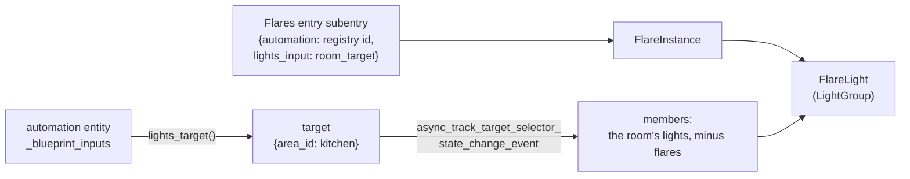
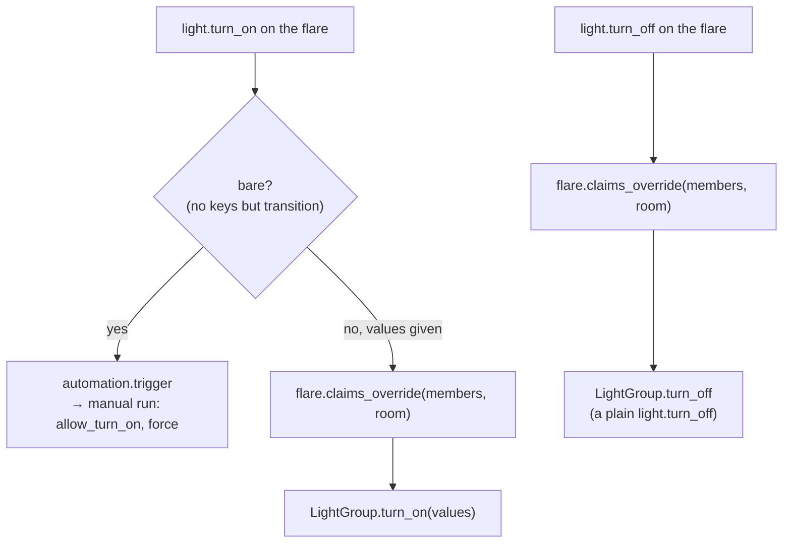

# How flares work
{: .no_toc }

{: .internals }
> Part of [Architecture]({{ site.baseurl }}/architecture/), for contributors and the curious.
> Nothing here is needed to use FLARE.

A flare (`light.<name>_flare`) is a light that fronts a room automation,
so a voice assistant, HomeKit or a dashboard can switch a room without
going around it. Saying "turn the kitchen on" to Siri goes to the flare,
and the flare runs the kitchen's automation. Siri's own "on" sent straight
to the bulbs would read as an override, and the room would be left at
whatever the bulbs restored to.

## What it is in code

`FlareLight` (`light.py`) subclasses HA's own `LightGroup`, so state,
brightness and colour are the group's, worked out from its members. Two
things differ from a plain light group: who its members are, and what
"on" means.

### Membership

A flare stores two things: its automation, by **entity-registry id** so a
rename doesn't orphan it, and the **name of the input** holding the
room's lights (`room_target` for our blueprint). It reads the input's
value live. A plain automation, not made from a blueprint, stores a
target instead.

- The inputs come from the automation entity's private
  `_blueprint_inputs` (`flares/automation.py:blueprint_inputs`). Its
  `raw_config` is the substituted config, so it doesn't have them. This is
  an accepted risk, kept to that one function, and the behaviour tests
  break if HA changes it.
- Members are tracked with
  `async_track_target_selector_state_change_event`, HA's own target
  resolution: the same rule as `flare.resolve_target`, so a flare's
  members are exactly its room's lights.
- It re-resolves on `automation_reloaded`, on entity-registry changes to
  automations, and once at `homeassistant_started` (automations load after
  integrations).
- **A flare is never one of a room's lights.** The room's tick would send
  it the curve, and the flare would pass that on to every bulb as an
  override. Three layers stop it: the blueprint rejects
  `integration_entities('flare')`, the services drop flare lights
  (`flares/identity.without_flares`), and a flare's own member filter drops
  other flares. Without the last, a flare could contain itself and
  recurse forever.

### On and off

- **A bare "on" runs the automation.** How a room comes on is the
  automation's decision. A manual run passes `allow_turn_on` and `force`,
  so "on" also takes back a room that was overridden.
- **"On" with values, and "off", mark the lights overridden first**,
  with the automation as the room, then send as any light group does.
  Without that, an unclaimed light (every light, once a room goes dark)
  would read `untracked`, and the run the change itself triggers would
  take it straight back to the curve. That's how Siri's "100 %" got
  dimmed back down. The override claim has a fresh context and no target,
  so it never matches; the room going dark hands the lights back.
- **Off is a plain `light.turn_off`, never `flare.turn_off`.** A flare's
  off is the user's. Recording it as FLARE's off would let a run landing
  while the room was half-off switch it back on.

It reaches `flare.claims_override` as a service call because that's the
Settings entry's, which may not be loaded. `has_service` checks first.

## The light platform only loads with flares

The Flares entry forwards the `light` platform only when it has at least
one flare, and remembers whether it did in `entry.runtime_data` so unload
matches. An empty entry has nothing to put on it, and setting `light` up
that early interfered with the behaviour tests' fake bulbs.

## Adding flares

- **Add Flare** lists only automations made from our blueprint. Any other
  automation goes through a custom path offering only inputs that can hold
  lights (`lights_input_kinds`).
- **Area setup adds them in bulk**, one subentry each, and the entry's
  update listener coalesces the reloads into one (`_async_reload_entry`).
- **Nothing creates a flare on its own** except area setup, where the user
  ticks the rooms. A HomeKit bridge including `light`, or a voice
  assistant exposing new entities, would otherwise put every room in the
  Home app after an update.
- A new flare's device goes in its automation's area once, at creation
  (`_place_in_area`). After that, the area is the user's.
