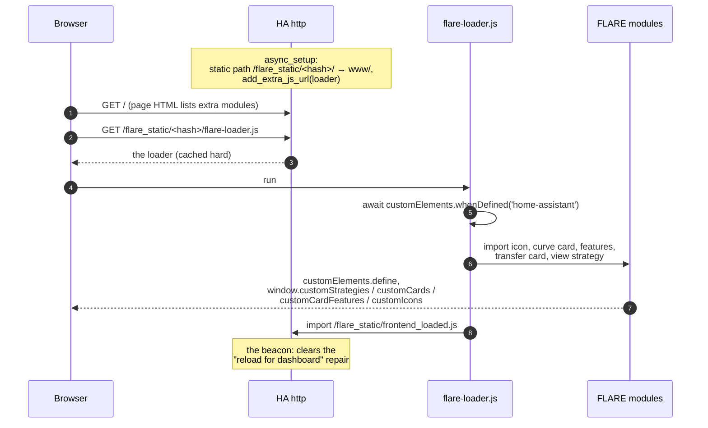
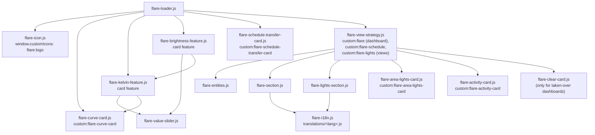
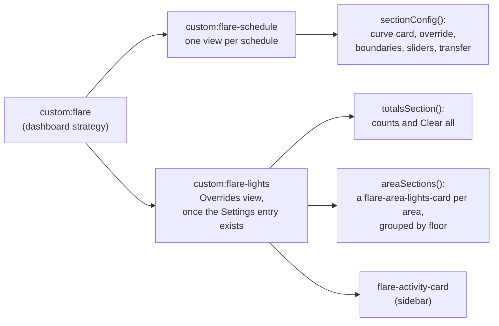

# Dashboard internals
{: .no_toc }

{: .internals }
> Part of [How it works]({{ site.baseurl }}/architecture/), for contributors and the curious.
> Nothing here is needed to use FLARE.

The dashboard is plain JavaScript modules in `custom_components/flare/www/`,
served by the integration itself. There's no build step and no
dependency. It's made of Lovelace **strategies**, which generate the
dashboard's config on every load, plus a handful of custom cards and card
features.

## Getting into the page

**The fingerprint.** The static path carries a hash of every file under
`www/` (`www_fingerprint()`), and is served with long-lived cache headers.
Any change to any file is a new URL. A version number wasn't enough: a dev
build is always `0.0.0-dev`, and Safari kept serving a stale strategy.

- It's a **path segment**, not `?v=`. The modules import each other
  relatively, and a relative import inherits the path but not a query, so
  `?v=` would load a module twice and the second `customElements.define`
  would throw. `test_static_imports.py` pins relative imports.
- **Any other fingerprint redirects** (302) to the current one
  (`OldFingerprintView`). A page served before an update, such as the
  service worker's stale copy or the companion app, still asks for the old
  hash, and a 404 would mean no dashboard at all.

**Waiting for `<home-assistant>`.** As it boots, HA's frontend installs a
scoped custom-element registry polyfill, replacing
`window.customElements`, while it loads integrations' modules in
parallel. A module that defined its elements first put them in the
browser's own registry, where HA never looks. The dashboard was then
listed but timed out when picked. So the loader waits for HA's own element
before importing anything. Outside HA, as in the docs playground, there's
nothing to wait for.

**A page open during first setup.** The frontend reads extra modules
only from the page HTML at load time, so a page open while FLARE is set up
never gets them. On HTTPS or `localhost`, the service worker serves the
first reload from its stale cache too. `dashboard_reload.py` handles both:
setup's summary and a repair link to a reload with a one-off query token,
a URL the service worker has never cached, with `target="_self"` so it's
a real page load. The beacon, imported last by the loader, clears the
repair. It sits under `/flare_static/` rather than `/api/` because HA's
CORS check rejects the `Origin` header a module import always sends.

## What registers what

Only modules that register something are imported by the loader. The rest
come in through their imports. `test_every_module_that_registers_something_is_loaded`
follows the imports from the loader.

## The strategies

`custom:flare` is listed under **Settings → Dashboards → Add dashboard**
through `window.customStrategies`. FLARE never creates the dashboard
itself: HA keeps the dashboards collection private.

Strategies regenerate on every load, so an update is the whole migration
and a new schedule or room just appears. **Take control** turns it into
ordinary YAML and is the one-way escape hatch.

**Entities are found by device and role, never by building ids.**
`flareDevices()` groups `hass.entities` by device, keyed by each entry's
translation key, which is its role (`morning_kelvin`, `schedule`,
`status`...). A renamed entity still shows. `flare-section.js` and
`flare-lights-section.js` return plain config objects, with no DOM, which
is what makes them testable under node.

## The cards

| Card | Reads | Notes |
|---|---|---|
| `flare-curve-card` | the schedule sensor's `points` and boundaries | one filled SVG path, simplified; corner easing never overshoots |
| `flare-kelvin-feature`, `flare-brightness-feature` | a `number` entity | HA's own `ha-control-slider`, filled with the value's colour |
| `flare-schedule-transfer-card` | `flare.export_schedule` / `import_schedule` | holds no copy of the YAML format |
| `flare-area-lights-card` | each light's status sensor | an area's lights, counts and Clear, worked out live in the browser |
| `flare-activity-card` | the logbook's `logbook/event_stream` for FLARE's device | rows are HA's own `ha-logbook-entry`, coloured by kind |

Two frontend internals are used knowingly, as accepted risks:
`ha-control-slider` (follow `hui-numeric-input-card-feature.ts` if it
breaks) and `ha-logbook-entry` (lazy-loaded, by having card helpers create
a logbook card first).

**Slider colour** is the curve's colour for the value, with 15 % of
`--primary-text-color` mixed in through `color-mix`. A near-white then
shows on a light card, and the theme decides which way it moves.

## Translations

HA's translations only reach an integration's backend strings, so the
cards carry their own: `flare-i18n.js` looks text up by key in
`www/translations/<lang>.js`, by the user's language, then its base
language ("de" for "de-CH"), then English. Composed names are patterns
(`{phase} colour temp`), since languages order words differently. Phase
names stay English as data, because they match the schedule sensor's
states, and are translated only for display.
`tests/unit/dashboard/test_i18n.py` holds every table to English's keys
and placeholders.

## Testing it

The dashboard's JavaScript runs under node in `tests/unit/dashboard/`, and
`tests/support/registry.py` builds `hass.entities` for its fixtures. For
the real thing, use the sandbox: add the FLARE dashboard and look.
