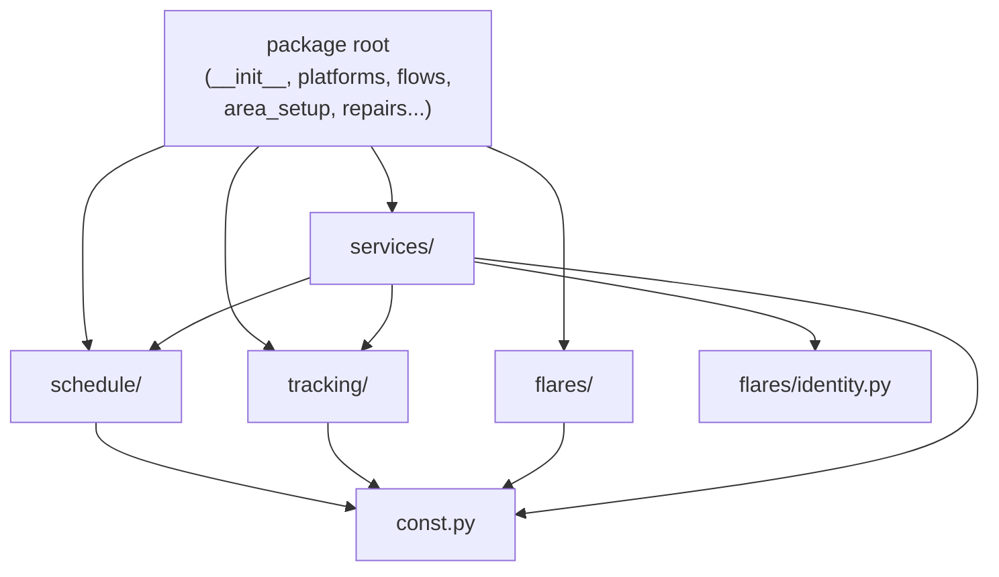
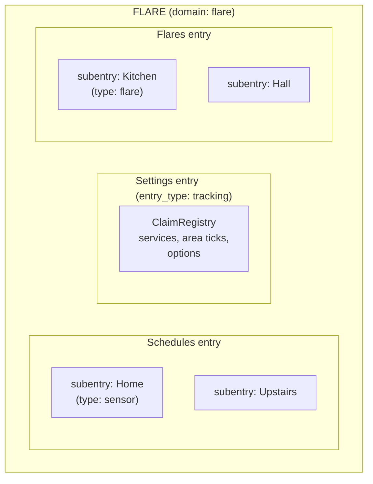
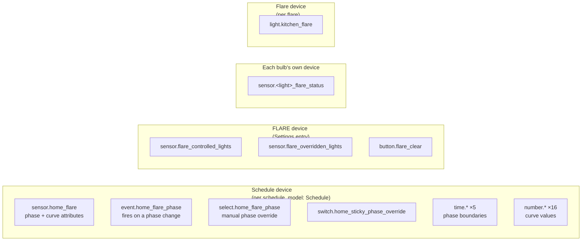

# Code layout
{: .no_toc }

{: .internals }
> Part of [Architecture]({{ site.baseurl }}/architecture/), for contributors and the curious.
> Nothing here is needed to use FLARE.

## The package

`custom_components/flare/` is grouped by **concept**, not by how a thing
is exposed. A schedule and the claims are each exposed both as entities
and as services, so grouping by exposure tangled them.

```
custom_components/flare/
├── __init__.py           setup and unload for all three entries; the area ticks
├── config_flow.py        the main flow: first setup, then "Set up area"
├── subentry_flows.py     add/reconfigure a schedule or a flare
├── options_flow.py       the Settings entry's options
├── area_setup.py         writes room automations to automations.yaml; room flares
├── blueprint_check.py    is our blueprint installed, and current? (repairs)
├── blueprint_version.py  the version stamp, pure
├── blueprint_translation.py  the blueprint in HA's language, pure
├── repairs.py            the fix flows for those repairs
├── dashboard_reload.py   getting the dashboard into a page open during setup
├── logbook.py            how the claim events read in the logbook
├── diagnostics.py        the Settings entry's diagnostics download
├── const.py              shared constants, and is_reachable()
│
├── sensor.py  select.py  number.py  time.py      entity platforms: HA imports
├── switch.py  button.py  event.py   light.py     these by name, so they stay here
│
├── schedule/             what lights should look like
│   ├── curve.py            the maths: phase_at(), targets_for_phase(), Kelvin→RGB
│   ├── coordinator.py      ScheduleCoordinator, ScheduleInstance, read_schedule()
│   └── transfer.py         a schedule as YAML
├── tracking/             who owns a light, and when each area ticks
│   ├── override_protection.py   classify(): the decision table, pure
│   ├── claims.py           ClaimRegistry: claims, rooms, the Store, the listener
│   ├── matching.py         does a light show a target? (the one value matcher)
│   └── ticker.py           TickScheduler: each area's tick, spaced apart
├── flares/               lights over automations
│   ├── automation.py       reading an automation's blueprint inputs
│   ├── bare.py             what counts as a bare turn-on
│   ├── identity.py         which lights are flares
│   └── instance.py         FlareInstance, from a subentry
├── services/             the services, and the planning behind them
│   ├── handlers.py         the lighting and claims services
│   ├── schedules.py        export_schedule / import_schedule
│   ├── targets.py          resolve_target, target_entities()
│   ├── grouping.py         build_groups(): lights → service calls, pure
│   ├── scenes.py           scene coverage, pure
│   └── two_step.py         two-step model patterns, pure
│
├── blueprints/flare.yaml the room automation
├── blueprints/translations/ its text in other languages
├── services.yaml  strings.json  translations/
├── brand/                the integration's icon
└── www/                  the dashboard (see frontend.md)
```

## The dependency rule

Dependencies run one way, and `tests/checks/test_layering.py` fails on a
new import that breaks it.



- `schedule/`, `tracking/` and `flares/` import only `const.py`. They
  never import each other.
- `services/` may use `schedule/`, `tracking/`, and from `flares/` only
  `identity.py` (which lights are flares, so the services can drop them).
- The root may use everything. `area_setup.py` lives there because it
  needs flares and the blueprint at once.
- `services/__init__.py` holds no imports.

Several modules are **pure**: no `hass`, only data in and data out.
`curve.py`, `override_protection.py`, `matching.py`, `grouping.py`,
`scenes.py`, `two_step.py` and `blueprint_version.py` are all tested
without Home Assistant (`tests/unit/`). Where pure code needs HA state, the
caller hands it a small adapter: `grouping.EntityLookup` and
`scenes.SceneLookup` are dataclasses of callables, filled in by
`services/handlers.py`.

### One definition each

A handful of rules are defined once and imported everywhere, because
copies drifted apart before. A check test fails on a new copy where one
is practical.

| Rule | Where | Check |
|---|---|---|
| Is a light reachable? | `const.is_reachable()` | `test_one_reachability_check.py` |
| Does a light show a target? | `tracking/matching.py` | `test_one_value_matcher.py` |
| Is a light ours, someone else's, or free? | `override_protection.classify()` through `classify_state()` | `test_one_classifier_adapter.py` |
| Which lights are flares? | `flares/identity.py` | |
| Which entities does a target reach? | `services/targets.target_entities()` | |
| What does a schedule hold? | `schedule/coordinator.read_schedule()` | |

## Three config entries

FLARE installs as three config entries. Home Assistant's integration page
shows one section per subentry with no way to group them by type, so the
entry is the only level that can group them.



Each entry carries `entry.data["entry_type"]`, and every platform module
branches on it. `async_setup_entry` treats anything that isn't Settings
or Flares as Schedules, so a new entry type has to branch before that
fallthrough. The Settings entry's stored type is `"tracking"`, from
before it was renamed.

What each entry keeps at runtime is its `entry.runtime_data`:

| Entry | `runtime_data` |
|---|---|
| Schedules | `{subentry_id: ScheduleCoordinator}` |
| Settings | the `ClaimRegistry` |
| Flares | `True` if it loaded the light platform (only when it has flares) |

## Devices and entities



- Every entity has `has_entity_name`, so renaming a device renames its
  entities. Nothing finds an entity by the id it was created with:
  `ScheduleInstance.current_id()` looks each one up by unique id, and the
  dashboard finds entities by device and translation key.
- **An entity's translation key is its role** (`schedule`,
  `morning_time`, `night_kelvin`, `status`, `all_controlled`, `clear`...).
  The dashboard relies on it (`flare-entities.js`), and
  `tests/functional/component/test_entity_roles.py` pins it.
- A light's status sensor sits on **the light's own device**, through
  `device_entry`, as HA's own helpers attach to a source device. A
  `DeviceInfo` with the device's identifiers would register a second
  device, since identifiers are unique per config entry.
- Schedule settings live in entity state, not in `subentry.data`: a change
  to subentry data reloads the whole entry.

## Tests mirror the layers

| Directory | Runs | Catches |
|---|---|---|
| `tests/unit/` | no Home Assistant | the pure modules and the dashboard's JavaScript (under node) |
| `tests/checks/` | the repo itself | layering, one-definition rules, translations, versions |
| `tests/functional/component/` | a real HA, FLARE set up directly | services, entities, claims, setup flows |
| `tests/functional/blueprint/` | the real blueprint, FLARE's services mocked | the blueprint's own wiring |
| `tests/functional/behaviour/` | the real blueprint, schedule and services, fake bulbs | what a room actually does |

Then there's the sandbox (`mise run sandbox`): a real HA running this
checkout over a fake house. It's for trying a change as a user would, and
it isn't a test layer. See [CONTRIBUTING.md](https://github.com/danrspencer/flare/blob/main/CONTRIBUTING.md).
