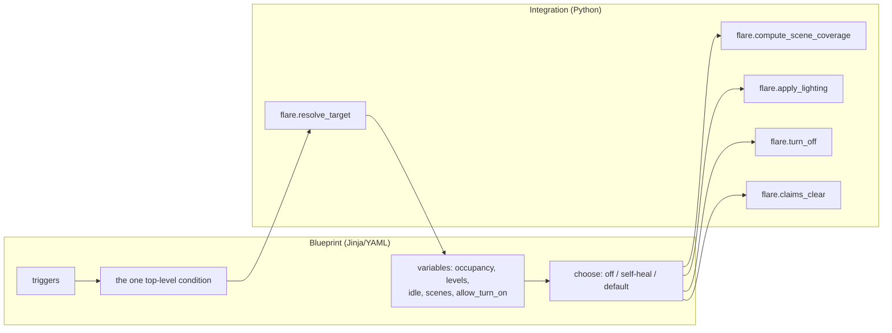
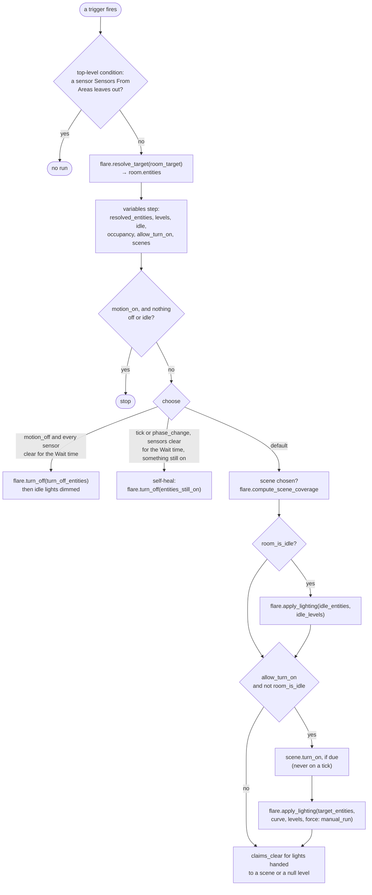
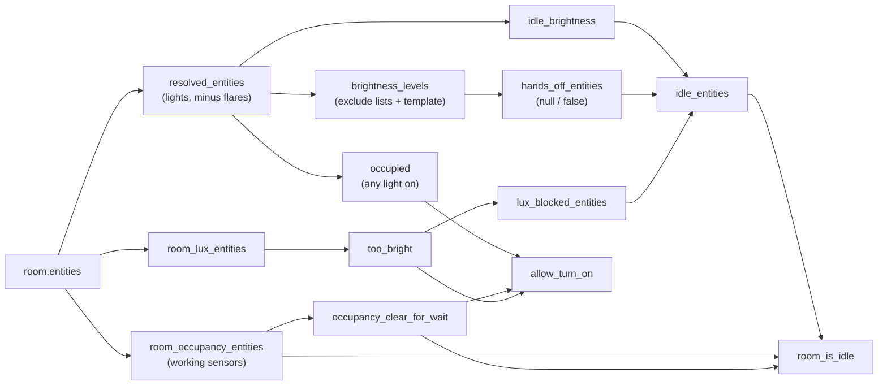

# The room automation
{: .no_toc }

{: .internals }
> Part of [Architecture]({{ site.baseurl }}/architecture/), for contributors and the curious.
> Nothing here is needed to use FLARE.

`custom_components/flare/blueprints/flare.yaml` is the blueprint each room
automation is made from. It decides **when** a room updates and **whether**
a light may come on. The services decide **how**: what to send, to which
bulbs, and which lights to leave alone.

## Why the split falls where it does

A `condition:` can't call a service. So anything a condition needs has to
be a template or a native condition, and that keeps triggers, conditions
and occupancy in the blueprint. Anything that needs HA's registries
properly (which lights are the room's), or is fiddly enough to want unit
tests (grouping, override protection), is a service the blueprint calls in
its `action:`.



## Triggers

| id | Fires on | Notes |
|---|---|---|
| `phase_change` | the schedule's Phase `event` entity | a real phase change, and once after setup |
| `tick` | `flare_tick` with this room's `tick_area` | the curve moves within a phase |
| `tick` | `time_pattern` every minute | only when the room names no area, chosen by `enabled:` |
| `extra` | Additional Triggers | any state change of entities the user picked |
| `motion_on` | `occupancy.detected`, `motion.detected` | native triggers over `room_target` |
| `motion_off` | `occupancy.cleared`, `motion.cleared`, held for Wait time | per sensor |
| `recovered` | template: some room light reachable, held 5 s | all the room's lights were unreachable and one is back |
| `lux_dark` | template: the room stops reading too bright (some illuminance sensor at or below Lux Threshold) | a wake-up only; the action re-checks |

`trigger_variables:` are the only variables a trigger can see. `tick_area`
is computed there, as the first `area_id` in `room_target`. Trigger
templates are *limited*: they can't call `area_devices()` and friends, so
`recovered` and `lux_dark` expand `room_target` by hand in Jinja. That's
close enough for a wake-up. The action works from the real resolution.

## The action, step by step



### The variables chain

`variables:` render top to bottom, once, when the run starts, and an
undefined name fails silently (`x | length` is 0). So order matters, and
the chain reads like this:



### The gate

Exactly two things can switch a light on, `scene.turn_on` and
`flare.apply_lighting`, and both sit inside one `if allow_turn_on` block
in `default:`.

```
allow_turn_on = manual_run
             or trigger.id == 'motion_on'
             or occupied                       # a light in the room is already on
             or (trigger.id == 'lux_dark' and not too_bright
                 and someone is in the room)
```

It must never gain a new way to become true without the user asking for
it explicitly. `test_no_trigger_reaching_default_can_light_a_dark_empty_room`
sweeps every trigger against it.

The one exception is **idle brightness**, the nightlight: an empty room
settles to its idle levels outside the gate. It's gated on
`room_is_idle` instead, and the curve's gate is `allow_turn_on and not
room_is_idle`. Without that, an idle light being on would make `occupied`
true, and the next tick would ramp the nightlight straight back up.

### Why there's no delay anywhere in `action:`

Variables are a snapshot taken when the run starts. A delay before acting
would act on that snapshot. A 0–15 s jitter delay once relit a light
switched off by hand inside the window, because the run had already
decided the room was in use. `test_nothing_delays_the_action_before_it_decides`
pins it. A trigger's own `for:` (as `recovered` and `motion_off` have)
isn't a delay in this sense, because the run, and so its variables, starts
after it.

## What the blueprint passes the services

| Field | Value | Why |
|---|---|---|
| `room_id` | `this.entity_id`, or none with Override Protection off | names the room for override protection; none means track nothing |
| `room_entities` | `resolved_entities` | the room's lights, released together once all are off |
| `brightness_levels` | per-light 0–255, `null`/`false` for hands-off | from the exclude lists and Brightness Template |
| `force` | `manual_run` | a manual run takes back overridden lights |
| `prefer_rgb_color` | the phase is in Prefer RGB During | routes RGB-capable bulbs to `rgb_color` |
| `transition` | slow for background updates, quick for motion or a manual run | `script_transition` |

## Occupancy, briefly

- `room_occupancy_entities` exists only to know whether the room has a
  sensor at all. `occupancy.is_detected` over zero entities is vacuously
  false, so a lights-only room would otherwise always read empty.
- An unavailable sensor is left out, so a room whose only sensor is dead
  counts as sensorless rather than empty.
- `occupancy_clear_for_wait` is a hand-written `now() - last_changed`
  check. The native `for:` needs the recorder to prime it after a restart,
  and that isn't reliable.
- With **Sensors From Areas** off, the native triggers still fire for
  every sensor in the target (a trigger's `target:` takes no templates),
  so the top-level `condition:` drops the ones not named directly.
