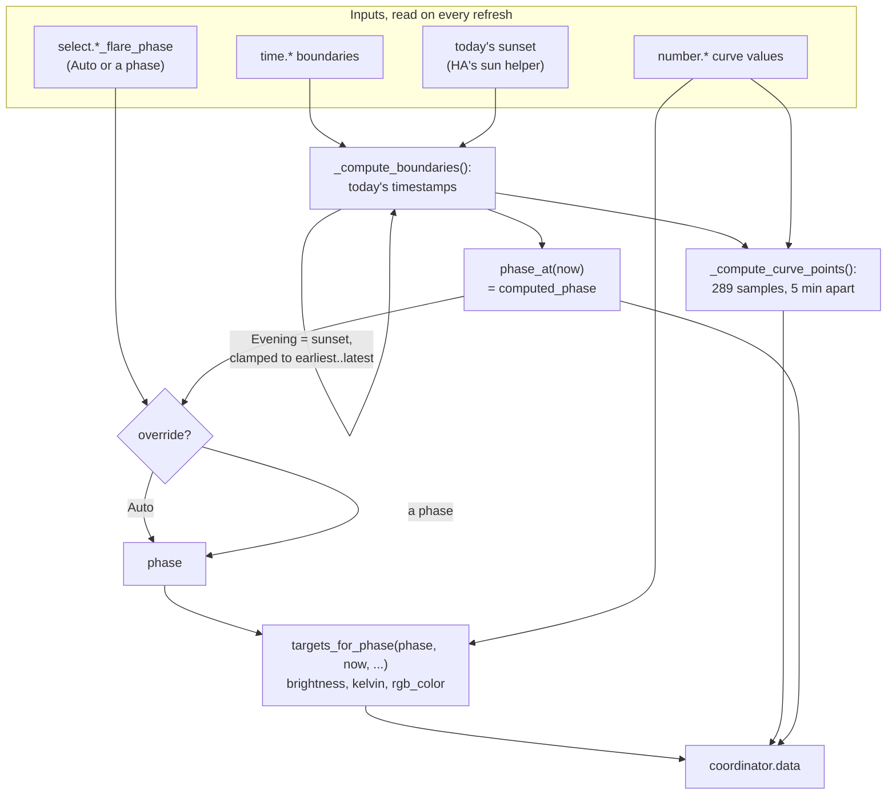
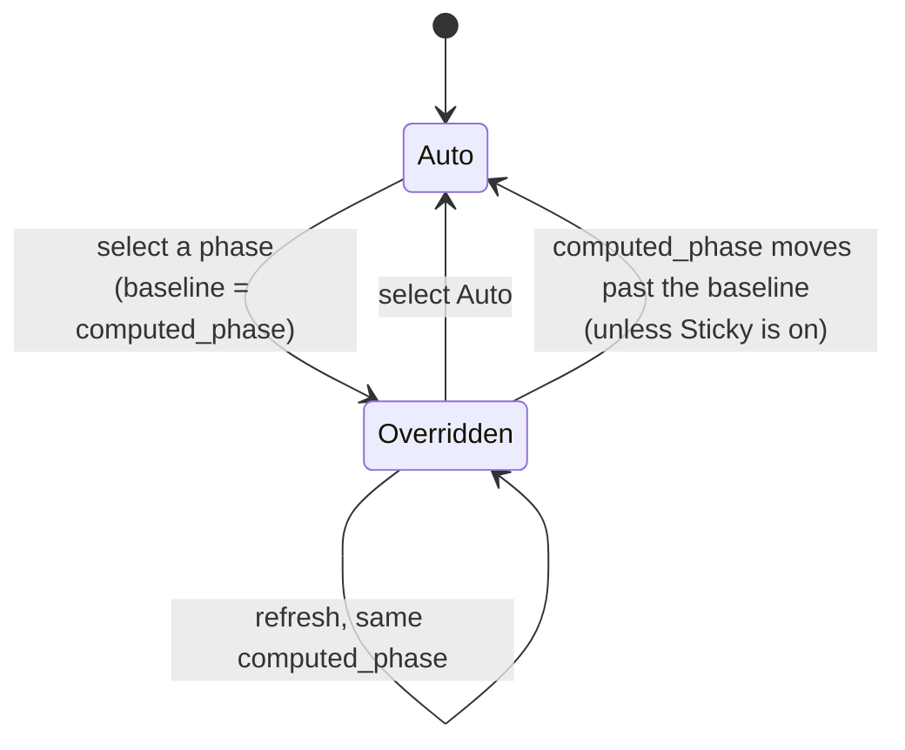

# Schedules and the curve
{: .no_toc }

{: .internals }
> Part of [Architecture]({{ site.baseurl }}/architecture/), for contributors and the curious.
> Nothing here is needed to use FLARE.

A schedule answers one question: what should a light look like right now?
It's a Python object (`ScheduleCoordinator`), the entities that hold its
settings, and the entities that publish its answer.

## Where a schedule's numbers live

A schedule has no stored configuration of its own. Its settings are 21
entities, each restoring its own value across a restart:

- five `time` entities, the boundaries: `morning_time`, `day_time`,
  `evening_earliest_time`, `evening_latest_time`, `night_time`
- sixteen `number` entities: each phase's brightness and Kelvin, and how
  many minutes before the next phase each starts easing towards it

They live in entity state rather than `subentry.data` because changing
subentry data reloads the whole entry. That also makes them ordinary HA
entities: an automation can change Evening's colour with
`number.set_value`, and the dashboard's sliders are just these numbers.

`read_schedule()` is the one place that reads them. It finds each entity
by unique id (`ScheduleInstance.current_id()`), so a renamed entity is
still read. It leaves out anything unreachable, and each caller decides
what that means: the curve falls back to the default, and an export omits
the value.

## From settings to targets

`coordinator.data` feeds every schedule entity:

| Entity | Shows |
|---|---|
| `sensor.<slug>_flare` | the phase as state; `brightness`, `color_temp_kelvin`, `rgb_color`, today's boundaries, `points` |
| `event.<slug>_flare_phase` | fires once per phase change, carrying the phase |
| `select.<slug>_flare_phase` | the manual override, which clears itself at the next natural boundary |

`points` (289 samples) is too big for the recorder, so it's in
`_unrecorded_attributes`. The dashboard's chart reads it live rather than
recomputing the curve.

### Refreshes

The coordinator refreshes every 60 seconds, and also:

- when any of its `time`, `number` or `select` entities is set
  (`async_request_refresh`, debounced to at most once per 10 seconds)
- twice at setup. The first refresh runs before the entities exist, so it
  uses defaults. The second runs once they've restored their values.

## The curve maths (`schedule/curve.py`)

Pure functions, with every literal a named default
(`DEFAULT_CURVE_VALUES`, `DEFAULT_SCHEDULE_HOURS`).

### Which phase is it?

`phase_at()` walks the boundaries in order: before Morning is Night, then
Morning, Day, Evening, and after the Night boundary it's Night again.

**A Night earlier than Morning is after midnight** (`_night_clock`). It's
tomorrow's boundary, and Evening runs on through midnight until it. Every
timestamp is shifted onto a clock where Night comes after Evening before
comparing.

```mermaid
gantt
    dateFormat HH:mm
    axisFormat %H:%M
    title Night at 01:00, after midnight
    section Phase
    Evening (from yesterday) :e0, 00:00, 01:00
    Night    :n, 01:00, 06:00
    Morning  :m, 06:00, 08:00
    Day      :d, 08:00, 17:30
    Evening  :e, 17:30, 23:59
```

Above, Evening runs from sunset to 01:00, and the 00:00 to 01:00 slot is
still yesterday's Evening. Without `_night_clock` a 01:00 Night would skip
Evening altogether and start at sunset.

### How bright, how warm?

Each phase holds its own value, then eases linearly to the next phase's
value over its last `<phase>_<brightness|kelvin>_transition` minutes, so
the next value arrives exactly at the boundary. The transition is clamped
to the phase's length; Day's Kelvin default (1440 minutes) spans the whole
of Day.

With the default settings and a 17:30 sunset, brightness runs:

| From | To | Brightness |
|---|---|---|
| 22:00 | 05:30 | 80 (Night) |
| 05:30 | 06:00 | 80 → 255, Night's 30-minute transition |
| 06:00 | 16:25 | 255 (Morning, then Day) |
| 16:25 | 17:30 | 255 → 180, Day's 65-minute transition |
| 17:30 | 21:00 | 180 (Evening) |
| 21:00 | 22:00 | 180 → 80, Evening's 60-minute transition |

`day_phase` is a **parameter**, not worked out from the time, because a
manual override passes a phase the clock disagrees with. So every ramp
clamps its factor and can't extrapolate. Strictly outside its own span, an
overridden phase returns its own value.

RGB is Kelvin converted, through HA's `color_temperature_to_rgb` with a
round-half-up wrapper that matches the card's `Math.round`.

### Kept in step with JavaScript

The dashboard's chart and the docs playground draw the same curve in
JavaScript. `tests/unit/dashboard/test_js_parity.py` holds `phase_at`,
`phase_marks` and the Night-after-midnight rule in step across the two.

## The phase override

The select stores the computed phase at the moment it was set (the
*baseline*). The override clears once the clock's phase moves on, so it
lasts until the next natural boundary rather than for a fixed time.
`switch.<slug>_sticky_phase_override` turns the clearing off. The
baseline isn't saved across a restart; a restored override takes the
phase at startup as its baseline.

## How a room hears about it

The blueprint reads a schedule two ways:

- **the Phase `event` entity** triggers a room on a real phase change
  (and once after setup, so a restart repaints every room). A trigger
  can't look up a device's entities, which is why it's an event entity on
  the schedule's device and not a template.
- **the schedule sensor's attributes**, read in `variables:` for
  `brightness`, `color_temp_kelvin` and `rgb_color`.

Between phase changes, the curve still moves within a phase, so rooms also
update on their area's [tick]({{ site.baseurl }}/architecture/event-loop/#timers).

## Export and import

`schedule/transfer.py` writes a schedule as YAML keyed by phase, and reads
it back. The `flare.export_schedule` and `flare.import_schedule` services
use it, as do Reconfigure, the transfer card and the docs playground.

- Parsed with PyYAML's `BaseLoader`, so every scalar is a string. YAML 1.1
  would read an unquoted `06:30` as the base-60 number 390.
- Written by hand so every time is quoted.
  `docs/assets/js/schedule-yaml.js` is the playground's copy, held to it by
  `test_schedule_yaml_parity.py`.
- Import parses the whole document first, then sets each value through
  `time.set_value` / `number.set_value`, exactly as moving a slider does.
