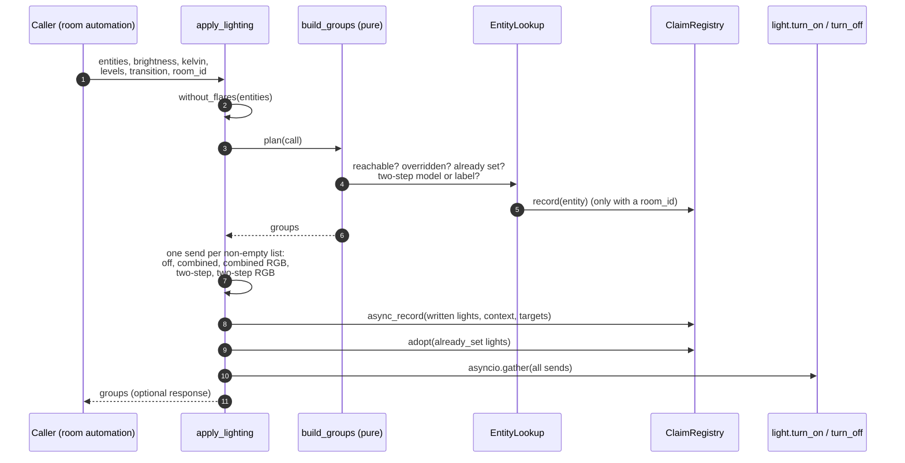
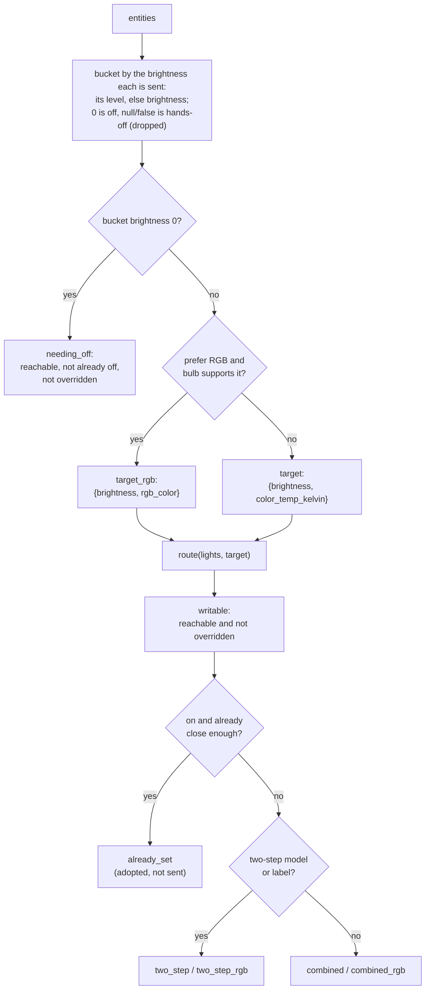
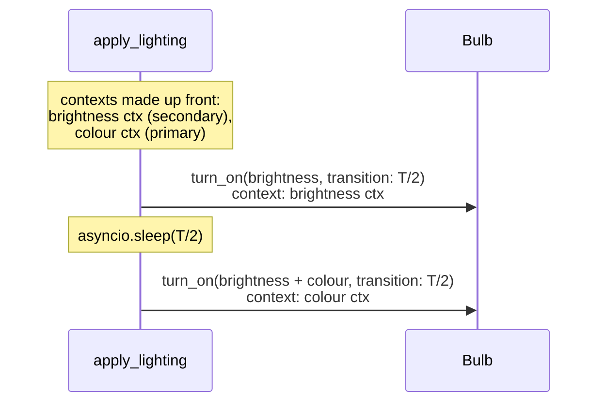

# Services and grouping
{: .no_toc }

{: .internals }
> Part of [Architecture]({{ site.baseurl }}/architecture/), for contributors and the curious.
> Nothing here is needed to use FLARE.

Everything FLARE does is a service anyone can call. The blueprint is one
caller, not the only one, so each service is written as a standalone tool.
The field contracts live in `services.yaml` and
[the services reference]({{ site.baseurl }}/reference/services/). This page is about what happens inside them.

## The twelve services

| Service | Kind | Registered by | Module |
|---|---|---|---|
| `compute_curve` | pure planner | Settings entry | `services/handlers.py` |
| `compute_lighting_groups` | pure planner | Settings entry | `services/handlers.py` |
| `compute_scene_coverage` | pure planner | Settings entry | `services/handlers.py` |
| `apply_lighting` | writes | Settings entry | `services/handlers.py` |
| `turn_off` | writes | Settings entry | `services/handlers.py` |
| `claims_check` | claims | Settings entry | `services/handlers.py` |
| `claims_record` | claims | Settings entry | `services/handlers.py` |
| `claims_clear` | claims | Settings entry | `services/handlers.py` |
| `claims_override` | claims | Settings entry | `services/handlers.py` |
| `resolve_target` | lookup | `async_setup` (always) | `services/targets.py` |
| `export_schedule` | schedules | `async_setup` (always) | `services/schedules.py` |
| `import_schedule` | schedules | `async_setup` (always) | `services/schedules.py` |

The handlers are thin adapters. They read HA state into the pure planners
(`grouping.py`, `scenes.py`, `curve.py`, `override_protection.py`) and
send the result. The last three need nothing of an entry, so they exist as
soon as the integration loads.

## `apply_lighting`, from call to bulb

Steps 3 to 9 contain no `await`. The registry's writers are callbacks, so
the plan and the claims are one atomic step: no state change can arrive
between deciding to write a light and recording that FLARE did.

## `build_groups`: lights to service calls

The goal is the fewest calls that move every light that needs it, and
nothing that doesn't.

**Two kinds of closeness**, and they're deliberately different:

- *Override matching* (is this still what FLARE set?) uses the tight
  tolerances: 2 brightness, 10 K, 10 per RGB channel, or the same mired.
- *Worth sending* (should FLARE bother?) widens that by the **minimum
  change**: 5 % of the target brightness and 5 mireds by default, from the
  Settings entry's options. Only grouping uses it. Widening override
  matching the same way would let a hand-set light near the curve pass as
  FLARE's.

Both go through `tracking/matching.shows()`, the one place a light's
reported values are compared with a target (see [Claims and override protection]({{ site.baseurl }}/architecture/claims/)).

**Brightness is clamped to 255** (`MAX_BRIGHTNESS`) before it's compared.
`light.turn_on` silently clamps, so an unclamped target would never read
as reached, and FLARE would resend it every tick.

### Two-step bulbs

Some bulbs (IKEA TRADFRI) drop the colour if brightness and colour change
in one transition. A light goes two-step if its device's
`"<manufacturer> <model>"` matches a glob in the Settings entry's
**Two-step bulb models**, or it carries the `no_combined_transition`
label.

Both context ids go into the claim, and a report under either counts as
FLARE's. The sleep is why claims are recorded first: a `mode: restart`
can cancel the run mid-sleep.

## `turn_off`

`flare.turn_off` records `{"state": "off"}` as each light's target, then
calls `light.turn_off`, as one operation and with **no** override
protection: a room emptying takes hand-set lights too. The off target is
what tells FLARE's off from anyone else's once the context has expired.
Callers mustn't split it back into a claim and a bare `light.turn_off`.

## Adoption

A light that's already on and showing what `apply_lighting` would send
gets no write. If it's unclaimed, `ClaimRegistry.adopt()` claims it as it
is, with its current context and values, and adds it to the room.
Otherwise, a Clear in a lit room would leave most lights unclaimed, and a
hand change to one would go unnoticed.

## `resolve_target`

`flare.resolve_target` returns the entities a target reaches by HA's own
rule (`helpers/target.py`, `async_extract_referenced_entity_ids`, with
`expand_group=False`). It's the same rule `light.turn_on area_id:` uses and
a flare's membership uses. Templates can't apply it: they can see
`is_hidden_entity`, but not `entity_category`, and `device_entities()`
misses child devices. `target_entities()` in the same module is what area
setup calls to decide which areas have lights.

## Scene coverage

`compute_scene_coverage` works out which of the room's lights a scene
covers (`scenes.py`, generic, nothing lighting-specific). A scene counts as
active only if it exists and everything it covers is within scope (the
room's entities plus every entity on each light's device). The blueprint
then sends the curve to the lights the scene doesn't cover, and releases
the claims on the ones it does.
