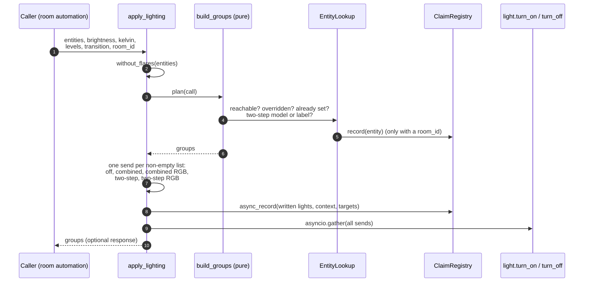
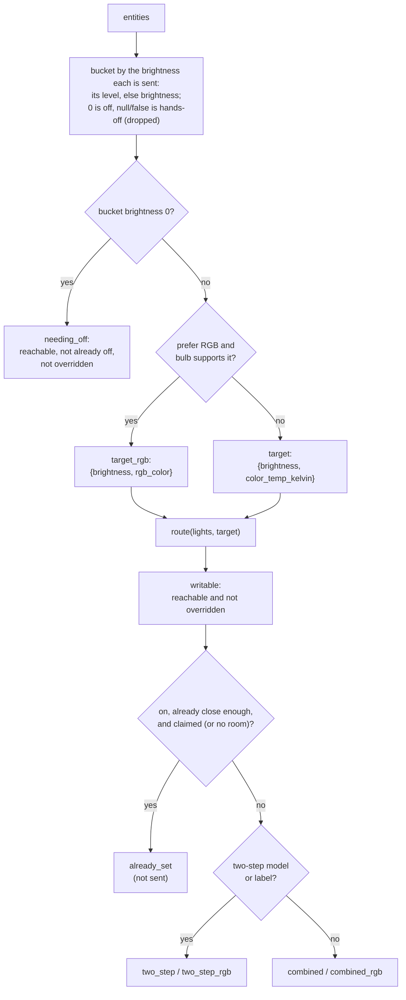
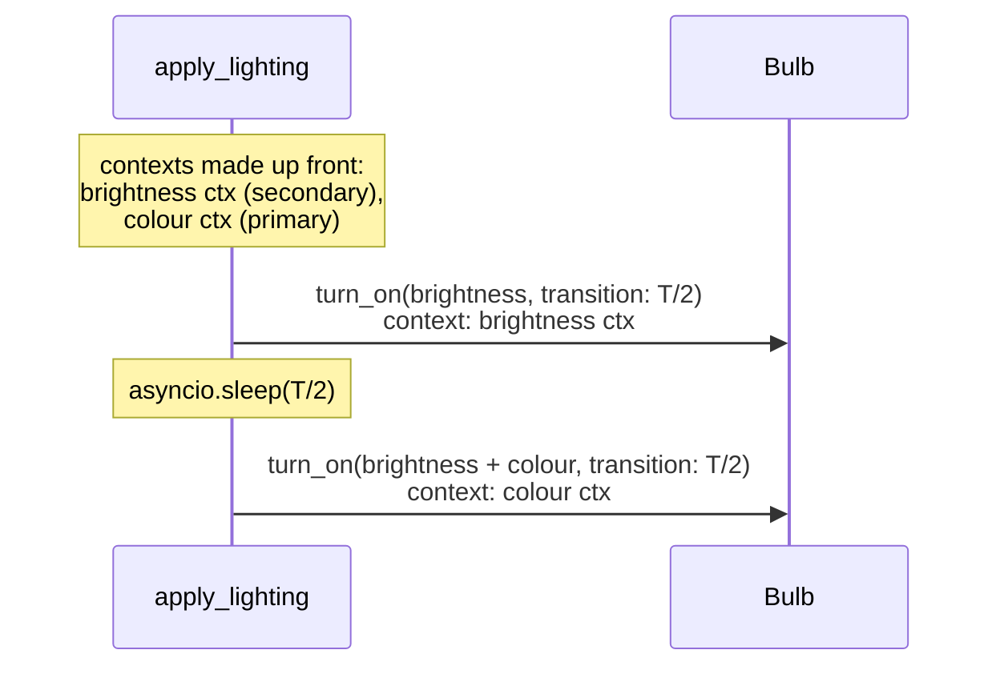

# Services and grouping
{: .no_toc }

{: .internals }
> Part of [Architecture]({{ site.baseurl }}/architecture/), for contributors and the curious.
> Nothing here is needed to use FLARE.

Everything FLARE does is a service anyone can call. The blueprint is one
caller, not the only one, so each service is written as a standalone tool.
The field contracts live in `services.yaml` and
[the services reference]({{ site.baseurl }}/reference/services/). This page is about what happens inside them.

## The eleven services

| Service | Kind | Registered by | Module |
|---|---|---|---|
| `compute_curve` | pure planner | Settings entry | `services/handlers.py` |
| `compute_scene_coverage` | pure planner | Settings entry | `services/handlers.py` |
| `apply_lighting` | writes | Settings entry | `services/handlers.py` |
| `turn_off` | writes | Settings entry | `services/handlers.py` |
| `claims_check` | claims | Settings entry | `services/handlers.py` |
| `claims_record` | claims | Settings entry | `services/handlers.py` |
| `claims_clear` | claims | Settings entry | `services/handlers.py` |
| `claims_override` | claims | Settings entry | `services/handlers.py` |
| `resolve_target` | lookup | `async_setup` (always) | `services/targets.py` |
| `export_schedule` | schedules | `async_setup` (always) | `services/schedules.py` |
| `import_schedule` | schedules | `async_setup` (always) | `services/schedules.py` |

The handlers are thin adapters. They read HA state into the pure planners
(`grouping.py`, `scenes.py`, `curve.py`, `override_protection.py`) and
send the result. The last three need nothing of an entry, so they exist as
soon as the integration loads.

## `apply_lighting`, from call to bulb

Steps 3 to 9 contain no `await`. The registry's writers are callbacks, so
the plan and the claims are one atomic step: no state change can arrive
between deciding to write a light and recording that FLARE did.

## `build_groups`: lights to service calls

The goal is the fewest calls that move every light that needs it, and
nothing that doesn't.

**One definition of closeness** answers both questions: *is this light still showing what FLARE
set?* and *is this light close enough that FLARE shouldn't send a command?* By default, the
**tolerances** are 5% of the target brightness and 5 mireds of colour temperature (configured on
the Settings entry, though a service call can override them). For an `rgb_color` target, FLARE
sums the differences across the red, green, and blue channels and allows up to twice the colour
tolerance (10 by default). Fixed floors handle device rounding at low values: at least 2
brightness points for dim targets, any two Kelvin values that floor to the same mired, and a
summed difference of at least 4 for RGB. Because 5% brightness and 5 mireds are roughly one
just-noticeable difference, any light close enough to skip sending is also never marked as
changed by someone else.

Both go through `tracking/matching.shows()`, the one place a light's
reported values are compared with a target (see [Claims and override protection]({{ site.baseurl }}/architecture/claims/)).

**Brightness is clamped to 255** (`MAX_BRIGHTNESS`) before it's compared.
`light.turn_on` silently clamps, so an unclamped target would never read
as reached, and FLARE would resend it every tick.

### Two-step bulbs

Some bulbs (IKEA TRADFRI) drop the colour if brightness and colour change
in one transition. A light goes two-step if its device's
`"<manufacturer> <model>"` matches a glob in the Settings entry's
**Two-step bulb models**, or it carries the `no_combined_transition`
label.

Both context ids go into the claim, and a report under either counts as
FLARE's. The sleep is why claims are recorded first: a `mode: restart`
can cancel the run mid-sleep.

## `turn_off`

`flare.turn_off` records `{"state": "off"}` as the target on each light that already holds a
claim (`ClaimRegistry.async_record_off`), then calls `light.turn_off` in a single operation
without checking override protection (an empty room turns off hand-set lights too). Recording the
off target is what distinguishes a FLARE turn-off from someone else switching a light off after
the 5-second context expires, which matters whenever other lights keep the room from going dark
(once a room is completely dark, it releases its claims anyway). `turn_off` takes no `room_id`
because claimed lights already belong to their rooms, and it creates no new claims on lights
that weren't already tracked. Callers must not split this into separate claim-recording and
`light.turn_off` calls.

## Unclaimed lights

If a light is already on and showing the values `apply_lighting` would send, FLARE skips sending
a command when the light already has a claim or when the call has no `room_id`. However, an
unclaimed light in a tracked room is written to anyway (`EntityLookup.unclaimed`), so that write
establishes FLARE's claim and adds the light to the room. After pressing **Clear** in a lit
room, this guarantees every light gets re-claimed with what FLARE actually sent rather than
trusting a stale state report from a bulb that just reconnected. The trade-off is one initial
write per light whenever a room starts tracking it.

## `resolve_target`

`flare.resolve_target` returns the entities a target reaches by HA's own
rule (`helpers/target.py`, `async_extract_referenced_entity_ids`, with
`expand_group=False`). It's the same rule `light.turn_on area_id:` uses and
a flare's membership uses. Templates can't apply it: they can see
`is_hidden_entity`, but not `entity_category`, and `device_entities()`
misses child devices. `target_entities()` in the same module is what area
setup calls to decide which areas have lights.

## Scene coverage

`compute_scene_coverage` works out which of the room's lights a scene
covers (`scenes.py`, generic, nothing lighting-specific). A scene counts as
active only if it exists and everything it covers is within scope (the
room's entities plus every entity on each light's device). The blueprint
then sends the curve to the lights the scene doesn't cover, and releases
the claims on the ones it does.
